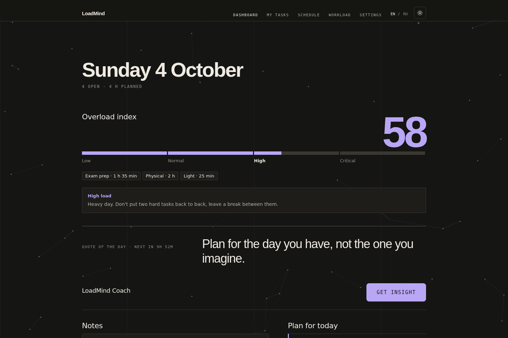
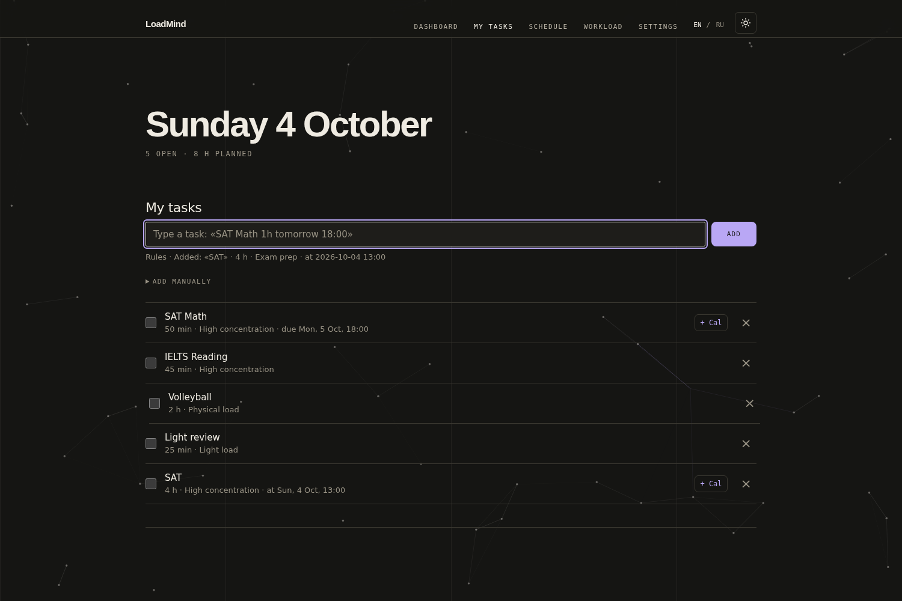
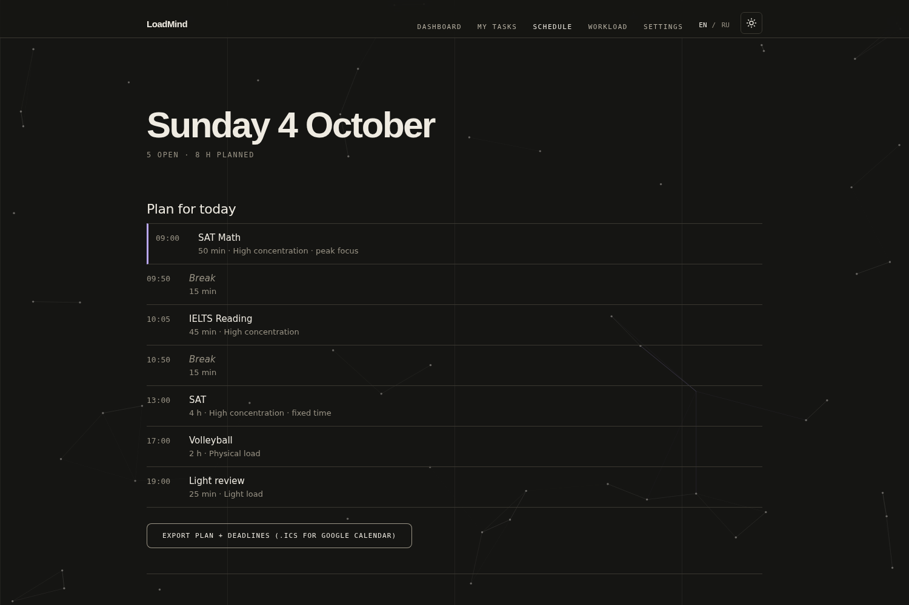
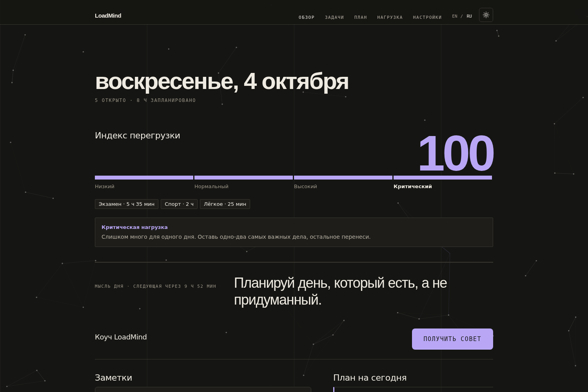

# LoadMind

LoadMind helps students plan their day. You type in your tasks, it builds a realistic schedule and tells you when a day is simply too much.

Live demo: https://loadmind.hassimx.workers.dev

## What it does

You add a task in one line, in English or Russian. "SAT 4 hours 13:00-17:00" becomes a task with a start time, and "by Friday 18:00" becomes a deadline. From your open tasks LoadMind makes a plan for the day. Hard tasks are placed at the hours when you focus best, and long sessions are followed by a break. The schedule itself is built by plain rules.

It also shows an Overload Index from 0 to 100. The number depends on how much work is still open, how many hours you can realistically handle in a day, and a short note you can write about how the day went. When you are happy with the plan, you can export it to Google Calendar, either as an .ics file or as a link for each task.

### Focus timer

The Focus tab has a Pomodoro timer: 25 minutes of work, a 5 minute break, and a longer break after every fourth session (all of it can be changed in Settings). You pick a task, or press ▶ next to it, and the minutes go into that task's progress, so the plan only counts the time that is still left. The tab also shows focus time for today and the last 7 days, and a streak of days with at least one session. The timer keeps going after a reload, plays a short sound at the end and shows a notification if you allow it.

### Planning tools

- Priorities: add `!`, `!!` or `!!!` (or `p1`–`p3`, «срочно», «важно») to a task. Important tasks go first in the plan.
- Repeating tasks: «every day», «по будням», «каждую неделю» or «every friday». When you tick one off, the next one appears on its day.
- Week view: the next 7 days with the hours planned for each day against your daily capacity, with overloaded days and deadlines marked.
- Deadline cushion: for every deadline LoadMind checks whether the work due by then fits into your free hours, and warns you when it is tight or will not fit.
- Unload today: when the day is in the critical zone, one button moves the least important flexible tasks to the next days that still have room. It never moves a task past its deadline, tasks with a fixed time, or urgent ones. The → button moves a single task one day forward.
- Reminders: browser notifications an hour before a deadline and a few minutes before a task with a start time (while the page is open).

  
  
  

## How it works

It is a plain web page with no build step. The markup is in index.html. script.js has the task parser, the planner, the overload index, the week view, the reminders and the calendar export. pomodoro.js is the focus timer. ui.js handles the language switch, the quote of the day and the background, and style.css has the look.

## Run it

Open index.html in your browser. There is nothing to install.

## Research behind it

The idea of putting hard work at your peak focus time comes from May, Hasher and Healey (2023): https://journals.sagepub.com/doi/10.1177/17456916231178553

Chronotype and grades turned out to be only loosely linked (Preckel et al., 2011), so LoadMind lets you choose your own peak time instead of guessing it: https://eric.ed.gov/?id=EJ938525

The 15-minute breaks are based on Albulescu et al. (2022): https://www.ncbi.nlm.nih.gov/pmc/articles/PMC9432722/

## Limits

Your tasks are stored only in your browser. They do not sync between devices, and clearing the site data will delete them.

## What I want to add next

Accounts with a database, two-way calendar sync, Telegram reminders (they would also work when the page is closed) and a Kazakh interface.

I built LoadMind on my own.
